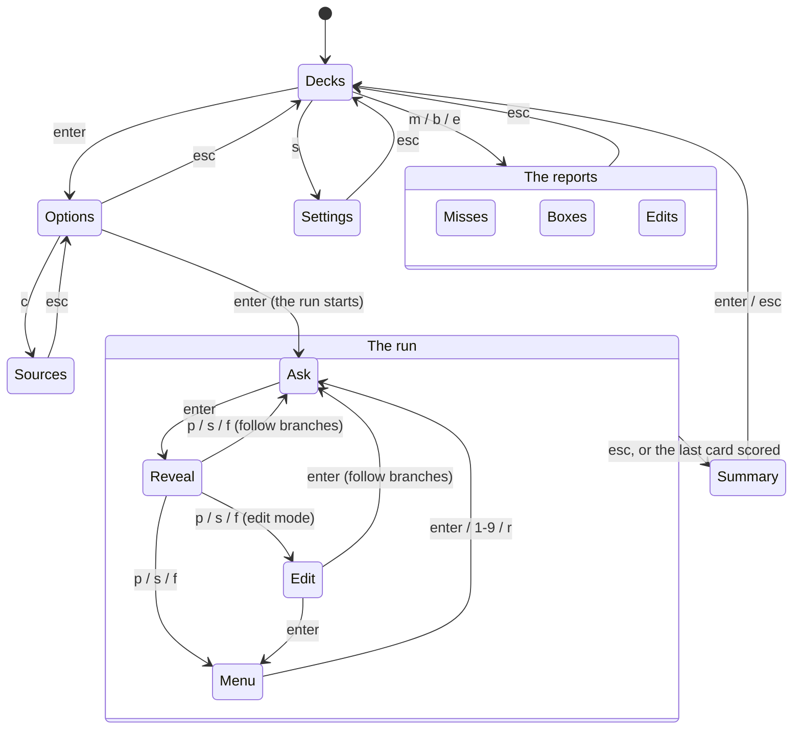

# TUI flows

Every screen the TUI has, what gets you to it, and where each key takes you.
The screens are the `screen` constants in `tui/model.go`; each one's page is
drawn in `tui/view.go` and its keys are handled in `tui/model.go` (`key`, or
`optionsKey` for the options screen).

A new screen, or a key that moves between screens, changes this file too.

## The map

`q` quits from the deck list and the summary. Everywhere else it does what
`esc` does. `ctrl+c` quits from anywhere.

## Screens

Where a screen's content is longer than the window, it scrolls with `j`/`k`,
`ctrl+d`/`ctrl+u`, `g`/`G` and the arrow and page keys. On the options screen
and the menu, `j`/`k` move the cursor instead.

### Decks (`decksScreen`)

The start. Every deck, with the highlighted one's description, counts and last
run beside the list. The run mode is chosen here, for every deck at once.

| Key | Does |
|---|---|
| `↑↓` `j/k` | move between decks |
| `tab` | switch classic / leitner, saved to `settings.json` |
| `enter` | the deck's options |
| `m` | the deck's miss list |
| `b` | the deck's Leitner boxes |
| `e` | the deck's edit list |
| `s` | the settings |
| `r` | reload the deck list |
| `q` | quit |

A deck that failed to load cannot be opened. Its error shows instead.

### Settings (`settingsScreen`)

What applies to lernt as a whole rather than to one deck, with a line under the
rows saying what the focused one does. Each change is saved as it is made
(`SaveSettings`), so `esc` only goes back to the decks, on the deck you left.

| Key | Does |
|---|---|
| `↑↓` `j/k` `tab` | move between rows |
| `←→` `h/l` `-/+` | turn the focused row |
| `space` | flip the mode; turn the other rows one step on |
| `esc` `q` | back to the decks |

The rows: the mode (the same choice `tab` makes on the deck list), and the cards
and seconds that the options screen starts from for a deck that sets neither
`count` nor `limit`. A deck's own values win, and so does anything already saved
for it on the options screen.

### Options (`optionsScreen`)

The run's settings for one deck, with a help card for the focused row, and
where the deck's cards come from underneath. The settings are loaded from, and
saved back to, the engine for that deck (`LoadOptions` / `SaveOptions`).

| Key | Does |
|---|---|
| `↑↓` `j/k` `tab` | move between rows |
| `←→` `h/l` `-/+` | turn the focused wheel |
| `space` | flip a toggle, or turn a wheel one step on |
| `/` | jump to the filter row, where typing edits the filter |
| `c` | every card source (listed in the key bar when some are hidden or cut) |
| `enter` `s` | save and start the run |
| `esc` `q` | save and go back to the decks |

On the filter row, letters go into the filter, so `c`, `s`, `q` and the `h/j/k/l`
keys type rather than act. `↑↓`, `enter` and `esc` still work.

A run the engine will not start (only the miss list, with nothing on it) stays
here and says why in the footer.

### Sources (`sourcesScreen`)

Every directory the deck's cards come from, each path whole. `esc` goes back to
the options with the cursor and settings as they were.

### Ask (`askScreen`)

The question, with the run's progress, the card's box and a clock in the title
bar.

| Key | Does |
|---|---|
| `enter` `space` | reveal the answer; the clock stops |
| `esc` `q` | end the run → Summary |

### Reveal (`revealScreen`)

The answer, and the time taken.

| Key | Does |
|---|---|
| `p` `s` `f` | score pass, shaky or fail |
| `esc` `q` | end the run, unscored → Summary |

After a score the run goes to the first of these that applies:

1. **Edit**, in an edit-mode run.
2. **Summary**, when that was the run's last card.
3. **Ask**, with follow branches on: the engine picks the next card.
4. **Menu** otherwise.

### Edit (`editScreen`)

Edit mode only: the scored card, and any notes or flags standing against it.

| Key | Does |
|---|---|
| `e` | open the card in `$VISUAL` / `$EDITOR`, then reload it |
| `n` | type a note |
| `x` | type why the card should be removed, and flag it |
| `d` | clear what stands against the card |
| `enter` | move on, as after a score (Summary, Ask or Menu) |
| `esc` `q` | end the run → Summary |

While a note or reason is being typed, `enter` saves it and `esc` drops it.

### Menu (`menuScreen`)

The card's follow-up branches, and a random card as the last row.

| Key | Does |
|---|---|
| `↑↓` `j/k` | move |
| `enter` | ask the card under the cursor |
| `1`-`9` | ask that branch |
| `r` | ask a random card |
| `esc` `q` | end the run → Summary |

### Summary (`summaryScreen`)

How the run went. Every way out of a run lands here.

| Key | Does |
|---|---|
| `enter` `esc` | back to the decks, on the deck you left |
| `q` | quit |

### Misses, Boxes, Edits (`missesScreen`, `boxesScreen`, `editsScreen`)

The deck list's three reports: the miss list, the cards by Leitner box, and what
edit mode has left standing against cards. All three are read-only and go back
to the decks with `esc`. The miss list also takes `a` to switch between the
miss list and every card attempted.

## Things that hold across screens

- **Waiting on the engine.** While a call is out, keys other than `ctrl+c` are
  dropped. A screen changes when the reply arrives, not when the key is pressed.
- **Errors** show in red in the footer, and the screen stays where it was.
- **Going back to the decks** reloads the deck list and puts the cursor back on
  the deck you left.
- **Resizing** clears and redraws the whole screen.
