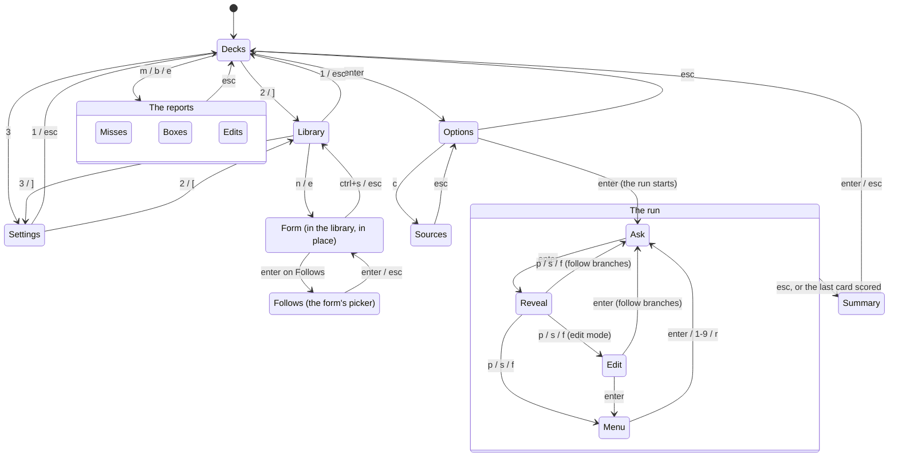

# TUI flows

Every screen the TUI has, what gets you to it, and where each key takes you.
The screens are the `screen` constants in `tui/model.go`; each one's page is
drawn in `tui/view.go` and its keys are handled in `tui/model.go` (`key`, or
`optionsKey` for the options screen).

A new screen, or a key that moves between screens, changes this file too.

## The map

The three screens along the top - Decks, Library, Settings - are tabs: `1`, `2`
and `3` go to each, `[` and `]` to the one before and after, from any of the
three. They are for the tab screens only; on a run and its options a digit is
not a tab. The deck highlighted follows you from one tab to the next.

The key hints at the bottom of each of the three say so: `1-3 change screen`. On the
Library's forms, where the digits are text, and on a selected settings row, they are
not offered.

`q` quits from the deck list and the summary. Everywhere else it does what
`esc` does. `ctrl+c` quits from anywhere.

## Layout

The TUI draws in the whole window, and follows it as it is resized. Two things are
kept still so that nothing jumps when you scroll quickly:

- **The key hints are the last lines of the window**, on every screen. The footer is
  always four lines: two for a status or an error (cut short if longer), and two for
  the hints, the first blank when they fit on one line. What comes and goes in the
  status does not move the hints, and neither does a screen with more or less on it.
- **Panes are the size the window gives them, not the size of what is in them.** On
  the deck list the two panes fill the height between the title bar and the footer,
  so they do not resize as the cursor moves between decks with more or less to say.
  In the Library the lists across the top and the card below share the height (the
  card a little over half), and the boxes of a form share the card's height
  (`boxRows`): they grow with the window, and a box does not change size as it fills.
  A list longer than its pane scrolls, with `▲ n more` and `▼ n more` on its first and
  last lines.

A page that reads better narrow, a question and its answer, keeps its own width.

Under tmux (`$TMUX` is set) the deck list, the main screen, shows a small note in the
status area, `! In tmux, lines containing emoji may look misaligned.`, and only there.
It gives way to a status or an error, and is cut to the window.

**Widths of emoji.** How many cells a character takes is up to the terminal, and
terminals disagree with the Unicode tables (tmux draws `1️⃣`, anything with a variation
selector, and everything in the emoji planes in two cells; the tables give some of
them one, and a lone skin tone none). Every width in the TUI comes from `width.go`,
which says the wider where they can differ, because a row a cell short only leaves a
border a cell out on that row, while a row a cell long wraps and pushes the whole page
down. As a last defence the terminal's automatic wrapping is turned off while the TUI
draws (and on again for the editor and on exit), so a row that is still too wide is cut
at the edge instead. The table it corrects was made by asking tmux for every emoji.

## Screens

Where a screen's content is longer than the window, it scrolls with `j`/`k`,
`ctrl+d`/`ctrl+u`, `g`/`G` and the arrow and page keys. On the options screen
and the menu, `j`/`k` move the cursor instead.

### Decks (`decksScreen`)

The start. Every deck, with the highlighted one's description, card count and last
run beside the list, and then what belongs to the mode: in classic the miss list, in
Leitner what is due today and the deck's cards by box (a chart of new, then each box).
The run mode is chosen here, for every deck at once.

| Key | Does |
|---|---|
| `↑↓` `j/k` | move between decks |
| `tab` | switch classic / leitner, saved to `settings.json` |
| `enter` | the deck's options |
| `m` | the deck's miss list |
| `b` | the deck's Leitner boxes |
| `e` | the deck's edit list |
| `r` | reload the deck list |
| `q` | quit |

The key bar lists only the keys of the mode in use: `m` in classic, where the
miss list drives runs, and `b` in Leitner, where the boxes do. The other still
works. A deck that failed to load cannot be opened. Its error shows instead.

With no decks the list says so and points at the Library.

### Library (`libraryScreen`)

Where decks and cards are read, made, edited and deleted. The decks and the
highlighted deck's cards, as a list of their questions, are side by side across the
top, and below them is the card under the cursor whole. A list that runs past its
pane says so: `▲ n more` in its first line where rows are hidden above, `▼ n more`
in its last where they are hidden below. In a window too narrow for two columns
all three stack.

The card below is where a card is read: its question, and under it the cards it
follows from (`↳ follows …`, so a question is seen in the context it is asked in),
its answer, its notes, where it leads (`→ …`, with the questions), and its time,
draft mark and reference. It changes as the cursor moves through the list. Writing
a card happens in the same place: `e` turns it into a form, and the lists above
stay, which is what lets the follow-ups be picked from them.

The cursor is a bar across its row: bright in the pane that has the keys, and only
a tint in the other, so it says where the cursor is without competing (with a `▌`
on the bright one for a terminal without colour). The pane that has the keys has
its title lit.

| Key | In the decks pane | In the cards pane |
|---|---|---|
| `↑↓` `j/k` | choose a deck | choose a card |
| `→` `l` `enter` | go to its cards | edit the card, in place |
| `←` `h` `esc` | back to the Decks tab | back to the decks |
| `n` | a new deck, in a form | a new card, in a form |
| `e` | edit the deck, in a form | edit the card, in place |
| `o` | open its `deck.toml` in `$VISUAL` / `$EDITOR` | open the card in the editor |
| `d` | delete the deck | delete the card |

Everything a deck or card holds can be done from the forms; the editor is for what
they cannot say. A deck that will not load has no form, since there is nothing to
fill it from: `o` opens its `deck.toml`.

`d` asks on the footer line, and only `y` does it; any other key keeps it. Nothing
is erased: the card or deck is moved to a `.trash` beside it (`DeleteCard`,
`DeleteDeck`). Deleting a deck moves the deck's own entry: a deck that keeps its
cards in its own folder takes them along, while a linked deck, or one that names a
bank elsewhere, such as a notes vault, leaves them where they are. The question
says which (`CardsInside`).

### Form (in the Library, in place of the card)

A deck or a card being written. It is drawn where the card was drawn, not on a
screen of its own, so the lists above stay in view. It has up to three columns,
each with its own vertical list of views:

- **the boxes**, on the left: a card's question, answer, notes and reference, one
  above the next, each a box that wraps and scrolls; a deck's name and what it is
  about;
- **Card options**, in the middle: the things that are not text, a card's time, its
  draft switch, and **Leads to**, the cards it goes on to. A deck has none, so its
  form has no middle column;
- **Actions**, on the right: Save, Open in editor, Cancel. They are a column of
  their own so that a card can have as many options as it needs and the actions
  are no further away.

The focused view is explained underneath. The arrow keys move between the views,
so a view is entered before it is used:

| Key | Does |
|---|---|
| `↑↓` `j/k` | move to the view above or below, in the same column (nothing wraps) |
| `←→` `h/l` | move to the next column left or right, to the view last on there |
| `tab` `shift+tab` | every view in turn (a backup for the arrows) |
| `enter` | on a box, start typing in it; on an option, select it; on Leads to, pick the cards; on an action, do it |
| `ctrl+s` | save, from anywhere |
| `ctrl+o` | save, then open the file in the editor, from anywhere |
| `esc` | leave the form without saving |

**How a view looks** is the same wherever `enter` selects something, in the forms
and on the settings screen. The three states of a view look alike and differ in how
much of it the cursor covers: with the cursor elsewhere it is plain; with the
cursor on it there is a block at each end (`▌` and `▐`); once it is selected the
cursor spans all of it, as a filled bar for an option and a tinted box for a box of
text.

While **typing** in a box the keys are the text's: `←→↑↓` move the cursor, `home`
and `end` go to the ends of the line, `backspace` and `delete` remove, `ctrl+u`
clears the box. `enter` is a new line in every box, and `esc` or `tab` ends the
typing. The cursor is drawn as the character it is on, reversed. A box for what is
one line in the file (the question, the reference, a deck's name and description)
can hold a newline as any other can; the engine makes it one line when it is saved.

While an option is **selected**, `←→` change it (with an arrow shown on each side it
can turn), `space` flips a switch, and `enter` or `esc` lets go. The arrows move to
another column, not change the option, when it is not selected.

Nothing is written until it is saved, and a refusal from the engine (a card that is
already there) is shown under the form with everything typed still in it. Saving a
card goes through `CreateCard` or `UpdateCard`, a deck through `CreateDeck` or
`UpdateDeck`, and the library comes back with the cursor on what was saved. Open in
editor saves first and, when the editor closes on a card, the deck is checked
(`CheckDeck`) and the first problem shown. If the editor fails the file stays as it
was, and its path is shown.

An edited card is written in the card format afresh, so what the format does not
hold is not kept: the callout on an answer becomes `tip`, and a line under the
rule that is not a reference, time, follow-up or tag is dropped. Its id, the
filename, never changes with its question, so links to it and its history hold.
The editor changes a card without that.

### Leads to (picking the cards, in the Library's list)

Enter on **Leads to** does not open a screen: the list of the deck's questions
above the form takes the picking. It is highlighted, each card has a box, and the
cards the edited card already leads to are ticked. The form below stays the card
being edited, and the card list moves without changing it, which is what lets you
choose. The card being edited is marked `(this card)` and passed over, since a card
cannot lead to itself. A new card has none to skip.

| Key | Does |
|---|---|
| `↑↓` `j/k` | move through the list |
| `space` `x` | tick or untick the card |
| `enter` | take the ticks back to the form |
| `esc` | leave them as they were |

### Settings (`settingsScreen`)

What applies to lernt as a whole rather than to one deck, with a line under the
rows saying what the focused one does. It is in tabs along the top of its card:
**Decks** (how decks are run), **Editing** (how cards are edited) and **Visual** (how
the TUI looks). Each change is saved as it is made (`SaveSettings`). The arrow keys
move between rows and tabs, so a row is selected before it is changed, and looks as
it does in the forms: a block at each end when the cursor is on it, a filled bar once
it is selected.

| Key | Does |
|---|---|
| `↑↓` `j/k` `tab` `shift+tab` | move between the rows of the tab |
| `←→` `h/l` | with no row selected, the tab before or after |
| `enter` | select the row |
| `←→` `h/l` `-/+` | change the selected row |
| `space` | flip the mode or the entities; turn the other rows one step on |
| `enter` `esc` | let go of the row |
| `esc` `q` | with no row selected, back to the decks, on the deck you left |

Opened with `3` from any tab. The rows:

- **Decks:** the mode (the same choice `tab` makes on the deck list); the cards and
  seconds that the options screen starts from for a deck that sets neither `count`
  nor `limit`, where a deck's own values win, and so does anything already saved for
  it on the options screen.
- **Editing: Emoji codes** (`entities` in `settings.json`: `on` is **as characters**, `off`
  is **as written**; as characters by default) is about an emoji written in a card's
  file as a code, such as `&#x1f534;` or `&#128308;`, which the card view already shows
  as the character. As characters, a card opened to be edited has those codes turned
  into the characters they stand for, so that saving it writes the characters (`🔴`).
  As written leaves the card's text exactly as it is in the file, codes and all. Only references to characters beyond ASCII are decoded:
  `&amp;`, `&lt;` and `&#60;`, which a card may mean literally, are never touched.
- **Visual** is the highlight colour: the lit titles and labels, the bar on the row the
  cursor is on, the box being typed in, and the charts. It is cyan unless changed. It is
  two settings, the second depending on the first.
  - **Colour mode** (`colour_mode`) is where the colour comes from: **Terminal theme**,
    **Custom** or **Colour wheel**.
  - **Theme colour**, in Terminal theme: one of the terminal's own 16 colours, black,
    red, green, yellow, blue, magenta, cyan and white and the bright ones, in the order
    of the palette (`colour_theme`). What each looks like is up to the terminal's theme,
    so each has a swatch drawn by the terminal: pick by what you see, not by the name.
    While the row is selected the swatch is blank: the bar is that very colour, and a
    swatch drawn on its own would end the bar where it ends.
  - **Custom colour**, in Custom: one of a list of your own (`colour_custom_choice`, and
    the list as JSON in `colour_custom`). **Add a colour** opens a form in the card, like
    the library's, with a **Colour** box, a **Name** box, and the actions Add and
    Cancel. The colour is read in any form: hex (`#ff8800`, `ff8800` or `f80`), a number
    from 0 to 255, or `r,g,b` (`255, 136, 0`, `rgb(255,136,0)`), and shown as a swatch as it
    is typed. The name is up to 24 characters and cannot be one already there, in any
    case. **Remove this colour** takes the one showing off the list, after asking; that
    row is there only while the list has something in it. The list is only added to and
    taken from, never edited: a colour to change is removed and added again. With
    nothing on the list the highlight is cyan.
  - **Wheel colour**, in Colour wheel: `enter` opens the wheel, a strip of hues over a
    square of that hue going from pale to full across and from bright to dark down,
    drawn in half blocks so each cell is two rows of pixels (`colour_wheel`, as
    `#rrggbb`). The highlight changes as the cursor moves, so what is picked is seen at
    once. The cursor is a half block, black or white whichever shows on the colour,
    on the half of its cell that it is on, and moves a pixel, half a cell, at a press.
    It needs a terminal that draws 24-bit colour to look smooth, and says when the
    terminal does not report that (`$COLORTERM`).

  | Key | Does, on the wheel |
  |---|---|
  | `↑↓←→` `h/j/k/l` | move in the square, or along the hues on the strip |
  | `shift` with an arrow, or `H/J/K/L` | bigger steps |
  | `tab` `shift+tab` | switch between the square and the strip of hues |
  | `,` `.` | the hue by a degree |
  | `enter` | use the colour |
  | `esc` | put back the colour that was there |

  The text on a bar is black or white, whichever stands out more from the colour. A
  value in the settings file that cannot be read is passed over.

### Options (`optionsScreen`)

The run's settings for one deck, with a help card for the focused row, and
where the deck's cards come from underneath. The settings are loaded from, and
saved back to, the engine for that deck (`LoadOptions` / `SaveOptions`).

| Key | Does |
|---|---|
| `↑↓` `j/k` `tab` | move between rows |
| `←→` `h/l` `-/+` | turn the focused wheel |
| `space` | flip a toggle, or turn a wheel one step on |
| `/` | jump to the filter row, where typing edits the filter |
| `c` | every card source (listed in the key bar when some are hidden or cut) |
| `enter` `s` | save and start the run |
| `esc` `q` | save and go back to the decks |

On the filter row, letters go into the filter, so `c`, `s`, `q` and the `h/j/k/l`
keys type rather than act. `↑↓`, `enter` and `esc` still work.

A run the engine will not start (only the miss list, with nothing on it) stays
here and says why in the footer.

### Sources (`sourcesScreen`)

Every directory the deck's cards come from, each path whole. `esc` goes back to
the options with the cursor and settings as they were.

### Ask (`askScreen`)

The question, with the run's progress, the card's box and a clock in the title
bar.

| Key | Does |
|---|---|
| `enter` `space` | reveal the answer; the clock stops |
| `esc` `q` | end the run → Summary |

### Reveal (`revealScreen`)

The answer, and the time taken.

| Key | Does |
|---|---|
| `p` `s` `f` | score pass, shaky or fail |
| `esc` `q` | end the run, unscored → Summary |

After a score the run goes to the first of these that applies:

1. **Edit**, in an edit-mode run.
2. **Summary**, when that was the run's last card.
3. **Ask**, with follow branches on: the engine picks the next card.
4. **Menu** otherwise.

### Edit (`editScreen`)

Edit mode only: the scored card, and any notes or flags standing against it.

| Key | Does |
|---|---|
| `e` | open the card in `$VISUAL` / `$EDITOR`, then reload it |
| `n` | type a note |
| `x` | type why the card should be removed, and flag it |
| `d` | clear what stands against the card |
| `enter` | move on, as after a score (Summary, Ask or Menu) |
| `esc` `q` | end the run → Summary |

While a note or reason is being typed, `enter` saves it and `esc` drops it.

### Menu (`menuScreen`)

The card's follow-up branches, and a random card as the last row.

| Key | Does |
|---|---|
| `↑↓` `j/k` | move |
| `enter` | ask the card under the cursor |
| `1`-`9` | ask that branch |
| `r` | ask a random card |
| `esc` `q` | end the run → Summary |

### Summary (`summaryScreen`)

How the run went. Every way out of a run lands here.

| Key | Does |
|---|---|
| `enter` `esc` | back to the decks, on the deck you left |
| `q` | quit |

### Misses, Boxes, Edits (`missesScreen`, `boxesScreen`, `editsScreen`)

The deck list's three reports: the miss list, the cards by Leitner box, and what
edit mode has left standing against cards. All three are read-only and go back
to the decks with `esc`. The miss list also takes `a` to switch between the
miss list and every card attempted.

## Things that hold across screens

- **Waiting on the engine.** While a call is out, keys other than `ctrl+c` are
  dropped. A screen changes when the reply arrives, not when the key is pressed.
- **Errors** show in red in the footer, and the screen stays where it was.
- **Going back to the decks** reloads the deck list and puts the cursor back on
  the deck you left.
- **Resizing** clears and redraws the whole screen.
